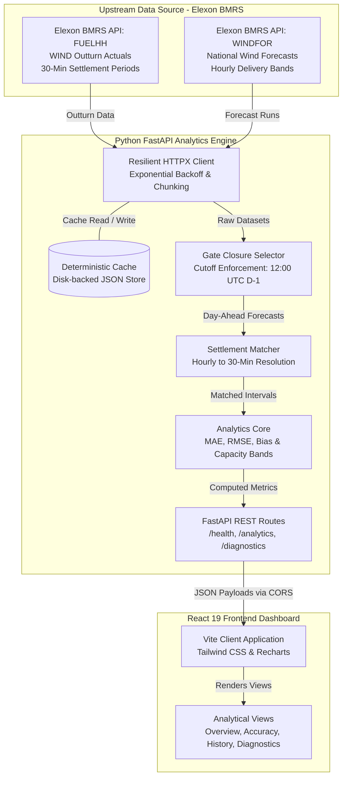

<div align="center">

# UK Wind Intelligence Platform
### High-Precision National Wind Generation & Day-Ahead Forecast Benchmarking

[](https://kjhwr-theta.vercel.app/)
[](https://fastapi.tiangolo.com)
[](https://react.dev)
[](https://www.docker.com)
[](https://data.elexon.co.uk/bmrs/api/v1)

<p align="center">
  <a href="https://kjhwr-theta.vercel.app/"><strong>Explore Live Dashboard »</strong></a>
  <br />
  <br />
  <a href="#system-architecture">Architecture</a> •
  <a href="#key-capabilities">Key Capabilities</a> •
  <a href="#analytical-methodology">Methodology</a> •
  <a href="#rest-api-specification">API Reference</a> •
  <a href="#local-development">Local Setup</a> •
  <a href="#production-deployment">Deployment Guide</a>
</p>

</div>

---

## Executive Summary

**UK Wind Intelligence** is an institutional-grade power market analytics platform engineered for electricity traders, power desk quants, and transmission operators. It automates the extraction, chronological pairing, and error benchmarking of Great Britain's national wind generation actuals against Day-Ahead hourly forecasts published on the **Elexon Balancing Mechanism Reporting Service (BMRS)**.

The system enforces strict **Day-Ahead Decision Gate Closure compliance** (12:00 UTC cutoff on D-1), eliminating look-ahead data leakage and providing mathematically rigorous metrics—**Mean Absolute Error (MAE)**, **Root Mean Square Error (RMSE)**, and **Directional Forecast Bias**—across all 48 half-hour settlement periods per day.

---

## Live Deployments

| Component | Target Platform | Endpoint / Live URL | Health Status |
| :--- | :--- | :--- | :--- |
| **Frontend Web App** | Vercel Edge CDN | [https://kjhwr-theta.vercel.app/](https://kjhwr-theta.vercel.app/) |  |
| **Backend REST API** | Render / Railway | `https://<your-backend-app>.onrender.com` |  |
| **Interactive API Docs** | Swagger / OpenAPI | `https://<your-backend-app>.onrender.com/docs` |  |
| **System Health Probe**| FastAPI Endpoint | `https://<your-backend-app>.onrender.com/health` |  |

---

## Key Capabilities

- **Strict Gate Closure Compliance**: Disqualifies any forecast published after the user-specified cutoff time (default: `12:00` UTC on D-1 for delivery on Day D). For each delivery interval, it selects the latest valid forecast issued prior to the cutoff threshold.
- **Resolution Normalization**: Bridges the structural mismatch between 1-hour WINDFOR forecast publications and 30-minute FUELHH outturn settlement periods.
- **Statistical Accuracy Engine**:
  - **MAE (Mean Absolute Error)**: Measures average deviation magnitude in megawatts (MW).
  - **RMSE (Root Mean Square Error)**: Highlights volatility and severe forecast excursions.
  - **Forecast Bias**: Discloses systematic over-forecasting ($+$ bias) or under-forecasting ($-$ bias).
  - **Matched Coverage Rate**: Verifies data completeness across the target window.
- **Trading Desk Sub-Views**:
  - **Overview**: Real-time KPI summaries, multi-curve visualization (Actual vs. Forecast with capacity bands), and interactive filter toolbars.
  - **Forecast Accuracy**: Error distribution histograms and capacity band analyses (Low, Medium, High wind regimes).
  - **Forecast History**: Multi-version publication logs, gate closure lookback comparisons, and lead-time audit trails.
  - **Data Quality & Diagnostics**: Settlement completeness audit, missing interval tracking, upstream BMRS latency monitoring, and deterministic cache telemetry.

---

## System Architecture



---

## Repository Directory Structure

```
kjhwr/
├── .env.example                     # Unified environment template with safe placeholders
├── .gitignore                       # Production rules (excludes secrets, build dirs & cache)
├── docker-compose.yml               # Multi-container orchestration with health dependencies
├── README.md                        # Master architectural and operational manual
│
├── backend/                         # High-performance FastAPI analytics backend
│   ├── .env.example                 # Backend environment variable template
│   ├── Dockerfile                   # Python 3.12-slim container with dynamic $PORT support
│   ├── requirements.txt             # Locked Python production dependencies
│   ├── app/
│   │   ├── main.py                  # Application factory, Starlette CORS middleware
│   │   ├── config.py                # Pydantic v2 application settings
│   │   ├── api/
│   │   │   ├── routes.py            # Endpoints (/health, /diagnostics, /analytics)
│   │   │   └── schemas.py           # Request & response Pydantic schemas
│   │   ├── services/
│   │   │   ├── elexon_client.py     # Resilient chunked BMRS API client
│   │   │   ├── forecast_selector.py # Decision gate closure cutoff enforcement
│   │   │   ├── matcher.py           # Hourly-to-half-hourly settlement pairing
│   │   │   ├── analytics.py         # Vectorized KPI & capacity band calculations
│   │   │   └── cache.py             # Deterministic disk-backed response cache
│   │   └── utils/
│   │       └── time.py              # Settlement period and UTC timestamp helpers
│   ├── data/cache/                  # Git-ignored cache store (tracks .gitkeep)
│   └── tests/                       # Complete pytest suite (unit + live BMRS tests)
│
└── frontend/                        # React 19 + TypeScript + Vite SPA
    ├── .env.example                 # Frontend environment variable template
    ├── Dockerfile                   # Multi-stage production build (Node 20 -> Nginx Alpine)
    ├── nginx.conf                   # Reverse proxy, caching headers & SPA fallback routing
    ├── vercel.json                  # Vercel deep-link routing rewrite rules
    ├── package.json                 # Scripts, dependencies, and type definitions
    ├── vite.config.ts               # Vite build and plugin configuration
    └── src/
        ├── App.tsx                  # Main router and shell layout
        ├── index.css                # Dark-mode design system tokens
        ├── components/
        │   ├── charts/              # ActualVsForecastChart, ErrorDistributionChart
        │   ├── dashboard/           # FilterToolbar, KpiGrid, CapacityBandCard
        │   ├── layout/              # Header, Sidebar, Live Status Badges
        │   └── tables/              # SettlementTable, ForecastPublicationTable
        ├── hooks/
        │   └── useWindData.ts       # Central data fetcher with status polling
        ├── pages/                   # Overview, Accuracy, History, DataQuality
        └── services/
            └── api.ts               # Typed REST client with VITE_API_BASE_URL resolution
```

---

## Analytical Methodology

### 1. Great Britain Settlement Hierarchy
The UK electricity network operates on a continuous 48-period settlement day. Each settlement period (SP) spans exactly 30 minutes in Coordinated Universal Time (UTC):

$$\text{SP}_1: \text{00:00–00:30 UTC} \quad \dots \quad \text{SP}_{48}: \text{23:30–24:00 UTC}$$

For the January 1–31, 2026 evaluation window, the platform evaluates:
$$31 \text{ days} \times 48 \text{ periods/day} = 1,488 \text{ discrete settlement intervals}$$

### 2. Day-Ahead Decision Gate Closure Filtering
To evaluate physical and financial trading performance without hindsight bias:
1. All WINDFOR forecasts published after the cutoff time (default: **12:00 UTC on D-1**) are excluded for delivery on Day D.
2. For each delivery interval, the **latest valid publication issued prior to the cutoff** is retained.
3. This models the exact information set available to market participants at Day-Ahead gate closure.

### 3. Resolution Alignment Engine
- **FUELHH Outturns**: Reported per half-hour settlement period.
- **WINDFOR Forecasts**: Published for 1-hour delivery intervals.
- **Normalization**: Each 1-hour forecast is mapped to its two constituent settlement periods:
  - Example: A forecast for hour ending `14:00` applies to **SP 27** (`13:00–13:30`) and **SP 28** (`13:30–14:00`).

### 4. Mathematical Formulations

Given $N$ matched settlement periods where $A_i$ represents actual generation and $F_i$ represents the selected Day-Ahead forecast:

$$\text{Forecast Error } (e_i) = F_i - A_i$$

$$\text{Mean Absolute Error (MAE)} = \frac{1}{N} \sum_{i=1}^{N} |F_i - A_i|$$

$$\text{Root Mean Square Error (RMSE)} = \sqrt{\frac{1}{N} \sum_{i=1}^{N} (F_i - A_i)^2}$$

$$\text{Forecast Bias} = \frac{1}{N} \sum_{i=1}^{N} (F_i - A_i)$$

$$\text{Coverage Rate (\%)} = \left( \frac{N_{\text{matched}}}{N_{\text{total}}} \right) \times 100$$

> **Bias Interpretation**: A positive bias ($+e$) denotes systematic over-forecasting (risk of short uncontracted generation), whereas a negative bias ($-e$) denotes systematic under-forecasting (risk of spill or curtailment).

---

## REST API Specification

### Base URL
- **Local**: `http://localhost:8000`
- **Production**: Configured via cloud container hosting (e.g., Render/Railway)

### Key Endpoints

#### 1. System Health & Upstream Probe
```http
GET /health
```
**Response (200 OK):**
```json
{
  "status": "healthy",
  "version": "1.0.0",
  "timestamp": "2026-10-24T14:45:00Z",
  "elexon_bmrs": {
    "status": "healthy",
    "latency_ms": 142.5,
    "endpoint": "https://data.elexon.co.uk/bmrs/api/v1/datasets/FUELHH"
  }
}
```

#### 2. Comprehensive Analytics Payload
```http
GET /api/v1/analytics?start_date=2026-01-01&end_date=2026-01-31&cutoff_time=12:00&force_refresh=false
```
**Query Parameters:**
| Parameter | Type | Default | Description |
| :--- | :--- | :--- | :--- |
| `start_date` | `string` | `2026-01-01` | Start of delivery window (`YYYY-MM-DD`). |
| `end_date` | `string` | `2026-01-31` | End of delivery window (`YYYY-MM-DD`). |
| `cutoff_time` | `string` | `12:00` | Gate closure cutoff in UTC (`HH:MM`). |
| `force_refresh` | `boolean` | `false` | Bypasses local disk cache when `true`. |

**Response (200 OK):**
```json
{
  "kpis": {
    "mae_mw": 2021.4,
    "rmse_mw": 2481.2,
    "forecast_bias_mw": 1806.1,
    "matched_data_coverage_percent": 100.0,
    "total_settlement_periods": 1488,
    "matched_periods": 1488,
    "unmatched_periods": 0
  },
  "capacity_band_breakdown": [
    { "category": "Low Wind (< 5 GW)", "period_count": 312, "mae_mw": 1140.2, "frequency_percent": 21.0 },
    { "category": "Medium Wind (5–12 GW)", "period_count": 784, "mae_mw": 1890.6, "frequency_percent": 52.7 },
    { "category": "High Wind (> 12 GW)", "period_count": 392, "mae_mw": 2984.1, "frequency_percent": 26.3 }
  ],
  "intervals": [ ... ],
  "publications_summary": [ ... ],
  "metadata": { ... }
}
```

#### 3. Data Diagnostics & Cache Telemetry
```http
GET /api/v1/data/diagnostics?start_date=2026-01-01&end_date=2026-01-31
```
Audits missing settlement periods, record deduplication counts, and local disk cache performance.

---

## Environment Configuration

Configuration is managed via environment variables. Copy `.env.example` to `.env` before running:

| Variable | Scope | Default | Description |
| :--- | :--- | :--- | :--- |
| `VITE_API_BASE_URL` | Frontend | `http://localhost:8000` | Target URL used by the browser client to initiate REST requests. Set to your deployed backend URL in production. |
| `BMRS_API_BASE_URL` | Backend | `https://data.elexon.co.uk/bmrs/api/v1` | Public Elexon BMRS endpoint. |
| `BMRS_API_KEY` | Backend | `""` *(empty)* | Optional scripting key for higher rate limits. |
| `DEFAULT_CUTOFF_TIME`| Backend | `12:00` | Default Day-Ahead decision gate closure time in UTC. |
| `DEFAULT_START_DATE` | Backend | `2026-01-01` | Default analysis range start date (`YYYY-MM-DD`). |
| `DEFAULT_END_DATE` | Backend | `2026-01-31` | Default analysis range end date (`YYYY-MM-DD`). |
| `CACHE_ENABLED` | Backend | `true` | Enables deterministic disk-backed caching. |
| `CACHE_TTL_HOURS` | Backend | `24` | Upstream cache invalidation lifespan. |
| `HTTP_TIMEOUT_SECONDS`| Backend| `30.0` | Upstream request timeout. |
| `MAX_CHUNK_DAYS` | Backend | `6` | Query chunk duration (respects Elexon 7-day API cap). |
| `CORS_ORIGINS` | Backend | `http://localhost:5173,http://127.0.0.1:5173` | Allowed origins (middleware regex also permits all `*.vercel.app` domains). |
| `PORT` | Backend | `8000` | Port for the Uvicorn application server. |

---

## Local Development

### Prerequisites
- **Python**: 3.11+
- **Node.js**: 18+ (npm 9+)

### 1. Backend Service
```bash
# Navigate to backend directory
cd backend

# Create and activate virtual environment
python -m venv .venv

# Windows:
.venv\Scripts\activate
# macOS/Linux:
source .venv/bin/activate

# Install dependencies
pip install -r requirements.txt

# Copy environment template
cp .env.example .env

# Run FastAPI development server with hot-reload
python -m uvicorn app.main:app --host 127.0.0.1 --port 8000 --reload
```
*API will be available at `http://127.0.0.1:8000` with Swagger docs at `http://127.0.0.1:8000/docs`.*

### 2. Frontend Dashboard
```bash
# In a new terminal, navigate to frontend directory
cd frontend

# Install npm packages
npm install

# Copy environment template
cp .env.example .env

# Start Vite development server
npm run dev -- --host 127.0.0.1 --port 5173
```
*Dashboard will be available at `http://127.0.0.1:5173`.*

---

## Containerized Deployment (Docker)

Both components can be orchestrated locally or in cloud container environments using Docker:

```bash
# Build and start all services in detached mode
docker compose up --build -d

# Inspect running container health status
docker compose ps

# Follow application logs
docker compose logs -f

# Stop and remove containers and networks
docker compose down
```

### Standalone Docker Images

**Backend Container:**
```bash
docker build -t uk-wind-intel-backend ./backend
docker run -p 8000:8000 -e CORS_ORIGINS="http://localhost:5173" uk-wind-intel-backend
```

**Frontend Container:**
```bash
docker build -t uk-wind-intel-frontend \
  --build-arg VITE_API_BASE_URL="http://localhost:8000" \
  ./frontend
docker run -p 5173:5173 uk-wind-intel-frontend
```

---

## Quality Assurance & Verification

### Backend Pytest Suite
Run the unit and integration test suite:
```bash
# Run unit tests (analytics, matcher, forecast selector, schemas, cache)
python -m pytest backend/tests/test_analytics.py backend/tests/test_api_routes.py backend/tests/test_cache.py backend/tests/test_forecast_selector.py backend/tests/test_matcher.py -v

# Run live Elexon BMRS integration tests
python -m pytest backend/tests/test_elexon_live.py -v
```

### Frontend Code Quality & Production Build
```bash
cd frontend

# Run Oxlint (116 rules checked across 26 files)
npm run lint

# Compile TypeScript and generate minified production bundle
npm run build
```

---

## Production Deployment Guide

### Architecture Overview
- **Frontend**: [Vercel](https://vercel.com) (Global Edge CDN, automated HTTPS, zero-config SPA rewrites).
- **Backend**: [Render](https://render.com) or [Railway](https://railway.app) (Python 3 container web service with health monitoring).

### Step 1: Deploy Backend on Render
1. Push your repository to GitHub: `https://github.com/Chandru9842/kjhwr`.
2. In the [Render Dashboard](https://dashboard.render.com/), click **New +** → **Web Service**.
3. Select `Chandru9842/kjhwr`.
4. Configure service parameters:
   - **Root Directory**: `backend`
   - **Runtime**: `Python 3`
   - **Build Command**: `pip install -r requirements.txt`
   - **Start Command**: `uvicorn app.main:app --host 0.0.0.0 --port $PORT`
5. Add Environment Variables:
   - `BMRS_API_BASE_URL`: `https://data.elexon.co.uk/bmrs/api/v1`
   - `CACHE_ENABLED`: `true`
   - `CORS_ORIGINS`: `https://kjhwr-theta.vercel.app`
6. Click **Create Web Service** and note your public backend URL (`https://<your-backend-app>.onrender.com`).

### Step 2: Configure Frontend on Vercel
1. Open your project on the [Vercel Dashboard](https://vercel.com/).
2. Navigate to **Settings** → **Environment Variables**.
3. Add the variable:
   - **Key**: `VITE_API_BASE_URL`
   - **Value**: `https://<your-backend-app>.onrender.com`
4. Under the **Deployments** tab, select **Redeploy** to compile the bundle with the backend URL.

### Step 3: Verify Public Integration
1. Navigate to [https://kjhwr-theta.vercel.app/](https://kjhwr-theta.vercel.app/).
2. Verify that the **System Status** badge displays a green indicator with `Live BMRS`.
3. Confirm that all four analytical views (**Overview**, **Forecast Accuracy**, **Forecast History**, and **Data Quality**) render live data without console errors.

---

## Data Governance & Attribution

- **Data Attribution**: Electricity generation outturns and forecasts are derived from the **Elexon Balancing Mechanism Reporting Service (BMRS)**.
- **Licensing & Terms**: Data is provided under the terms of the UK Balancing and Settlement Code (BSC) open data policy.
- **Application Code License**: Distributed under the [MIT License](https://opensource.org/licenses/MIT).

---

<div align="center">
  <sub>Engineered with precision for GB power market analytics. Pair-programmed with Google Antigravity IDE.</sub>
</div>
